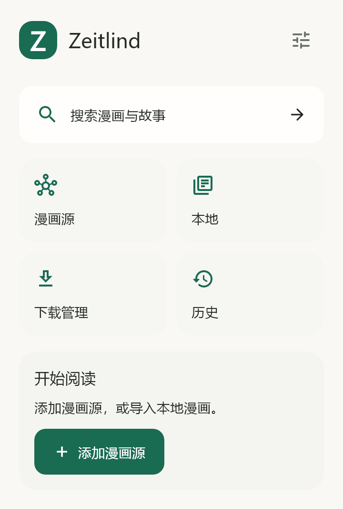

# Zeitlind

一个支持 Android 和 Windows 的漫画阅读器。管理本地书库，连接漫画源，按自己的节奏阅读。

[下载 Android 安装包](https://github.com/RETEMPT/Zeitlind/releases/latest) · [全部版本](https://github.com/RETEMPT/Zeitlind/releases)



## 功能

- 本地漫画导入、收藏、历史与继续阅读。
- JavaScript 漫画源、聚合搜索、章节下载与离线阅读。
- 源目录搜索与筛选，支持 Komga、Kavita 等自建书库适配。
- 源链接自检、GitHub 链接转换、已知镜像重试和更新失败回滚。
- 标准、日漫、条漫阅读预设及细项设置。
- 默认黑白配色、深浅模式，支持主色、色相、饱和度和背景染色调节。
- 统一导入 Venera 源脚本与 JSON 目录，通过 Suwayomi 接入 Mihon 扩展。
- 可选 WebDAV 同步与备份导入导出。

## 安装

在 [Releases](https://github.com/RETEMPT/Zeitlind/releases) 下载 APK：

| 安装包 | 适用设备 |
| --- | --- |
| `arm64-v8a` | 大多数近年的安卓手机，优先选择 |
| 不带架构后缀的通用包 | 不确定设备架构时使用 |
| `armeabi-v7a` | 32 位 ARM 设备 |
| `x86_64` | 对应架构的模拟器或设备 |

下载页面附带 `SHA256SUMS` 和公开签名证书。后续版本使用同一签名以支持覆盖更新。

Windows 下载 `windows-x64.zip`，完整解压后运行 `zeitlind.exe`，保留同目录的 DLL 和 `data` 文件夹。

Android 若未自动创建桌面快捷方式，可在应用列表找到 Zeitlind，再到设置 → 外观 → 添加到桌面。是否自动放置图标由桌面启动器决定。

## 漫画源

首页 → 漫画源。导入框会自动区分源脚本和目录链接，JSON 目录会打开列表供选择，不再当作 JavaScript 执行。支持 GitHub 文件页、Venera 链接、粘贴脚本及 `.js` / `.json` / `.txt` 文件，也支持带 BOM 的 UTF-8 和 UTF-16 文件。

首次联网启动会在后台自动安装原生目录的全部 31 个源，逐个保存完成进度。初始脚本固定到原生仓库修订并校验 SHA256；失败或中断后可继续，漫画源页的恢复按钮会补齐缺失项目。已有源按站点去重并保留设置；主动删除的默认源不会在下次启动时自动装回。

默认使用 [Venera 原生目录](https://git.nyne.dev/nyne/venera-configs/raw/branch/main/index.json)，保留 CDN、GitHub、集成仓库精选及完整目录作为补充。可在目录中继续添加其他站点；同站点的重复条目会合并，安装时也会检查重复。源脚本的更新仓库地址不会被误当成漫画网站。

| 来源格式 | 接入方式 |
| --- | --- |
| Venera `.js` | 直接安装，兼容原生源设置、账号与动态选项 |
| Venera JSON 目录或目录导出 | 自动识别，浏览后安装；保存多个仓库并检查更新 |
| Mihon / Tachiyomi / Komikku 扩展 | 通过自备的 Suwayomi 服务器运行，连接后导入服务器已安装的源 |
| 阅读 / Legado 规则 | 引擎不同，需要对应的 Venera 版本；不会假装兼容或直接执行 |

Suwayomi 入口支持源列表、搜索、漫画详情、章节、图片和可选 Basic 认证。扩展安装及站点专属设置在服务器管理页面完成。APK / Protobuf 仓库链接会引导至此入口。

默认目录可切换 CDN 与 GitHub 直连。安装后可运行“漫画源自检”。自检检查脚本链接与源标识；登录、搜索和具体章节阅读仍取决于站点状态。只安装信任的源。

应用不捆绑漫画内容或远程源脚本。自建书库需要填写自己的服务器地址和账号。

## 数据迁移

Zeitlind 使用独立应用标识 `dev.zeitlind.reader`，可以与原版同时安装。设置中支持导入旧 `.venera` 备份；新备份使用 `.zeitlind`，WebDAV 只轮换 Zeitlind 备份。

## 从源码构建

使用 Flutter **3.41.4**、Android SDK、JDK 17 和 Rust。调试构建不需要发布密钥：

```sh
flutter pub get
flutter test
flutter build apk --debug
```

正式发布需配置自己的 `android/key.properties` 与签名密钥。构建脚本、依赖版本和测试随源码提供；开发笔记与内部验证报告保存在本地。

## 许可

GNU GPL v3，见 [LICENSE](LICENSE) 与 [NOTICE](NOTICE)。Zeitlind 是独立修改版，原有版权和第三方许可声明保留。
